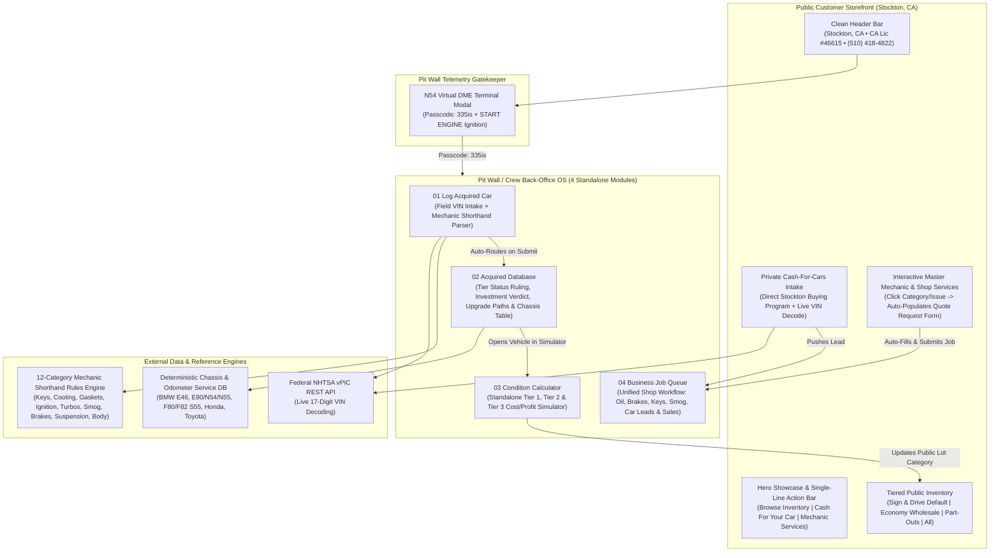

# MAKI MOTORSPORTS LLC
### Licensed California Auto Dealer (`#46615`), Master Mechanic Shop & Pit Wall Telemetry OS

[](https://developer.mozilla.org/en-US/docs/Web/JavaScript)
[](https://tailwindcss.com/)
[](https://vpic.nhtsa.dot.gov/api/)
[](https://drive.dmvonline.ca.gov/s/oll)
[](https://maki-motorsports.vercel.app)

> **Live Production Website:** [https://maki-motorsports.vercel.app](https://maki-motorsports.vercel.app)  
> **GitHub Pages Mirror:** [https://domswooz.github.io/MAKI-MOTORSPORTS/](https://domswooz.github.io/MAKI-MOTORSPORTS/)  
> **Operating Location:** Stockton, CA • `(510) 418-4822` • CA Dealer License `#46615`  
> **Instagram:** [`@makimotorsportsllc`](https://www.instagram.com/makimotorsportsllc/)

---

## Executive Overview

**Maki Motorsports LLC** combines a public-facing **Stockton, CA dealership & Master Mechanic storefront** with a passcode-gated **Pit Wall Telemetry & Reconditioning OS** (`Passcode: 335is`) designed for rapid field use on desktop, mobile, and foldable displays (including Samsung Galaxy Z Fold 7 & Fold 8).

Because every vehicle is acquired, diagnosed, keyed, and reconditioned in-house by a Master Mechanic equipped with automotive locksmith/immobilizer programming tools, Maki Motorsports eliminates third-party retail shop markups—unlocking higher cash-for-cars payouts for local sellers and transparent 3-tier inventory options for buyers.

---

## System Architecture



---

## Core Features & Innovations

### 1. Public Customer Storefront
* **Privacy-First Licensing Compliance**: Displays only the verified California DMV Dealer License number (`#46615`), operating city (`Stockton, CA`), and direct business phone (`(510) 418-4822`), keeping personal and wholesale partner records strictly private.
* **Centered Category-First Inventory**: Defaults to **Sign & Drive** certified retail vehicles when customers click *Inventory & Part-Outs*, with instant filtering across:
  * **Sign & Drive**: Turnkey retail vehicles fully inspected, smogged, and keyed in-house.
  * **Economy Wholesale**: Budget-friendly mechanical specials priced near wholesale.
  * **Part-Outs**: Donor chassis for OEM engines, transmissions, body panels, and electronics.
  * **All Inventory**: Complete lot view.
* **Private Direct Cash-for-Cars Program**: Allows local sellers to decode their 17-digit VIN via the federal NHTSA vPIC API and submit vehicles running, broken, or with lost keys directly into the internal Business Job Queue.
* **Interactive Master Mechanic & Shop Services**: Features 4 interactive service categories (**Oil & Preventative Maintenance**, **Brakes, Suspension & Chassis**, **Key Programming & Locksmith**, **Diagnostics, Smog & Engine Work**) with 16 clickable sub-service pills. Clicking any category or sub-issue automatically populates the request form below and scrolls to the vehicle/contact fields.

### 2. Pit Wall / Crew Gatekeeper (`Passcode: 335is`)
* **Motorsports Telemetry Terminal**: Clicking **`Pit Wall / Crew`** in the top navigation bar opens an N54-inspired virtual DME terminal.
* **Ignition Authentication**: Entering chassis code **`335is`** and pressing the glowing crimson **`START ENGINE`** button unlocks the 4-module dealer back-office.

### 3. Pit Wall Back-Office OS (Foldable & Mobile Ready)
* **`01 Log Acquired Car`**:
  * Field intake form supporting live 17-digit NHTSA VIN decoding, purchase price, MMR baseline, mileage, and **Mechanic Shorthand** notes (e.g., `lost key`, `coolant leak`, `valve cover gasket`, `misfire`, `smog / p0420`, `front bumper`, `brakes`, `turbo rattle`).
  * Submitting a vehicle automatically parses every issue, builds 3 reconditioning tiers, and routes directly to **`02 Acquired Database`**.
* **`02 Acquired Database`**:
  * **Tier Status Ruling & Reasoning**: Explains which tier the vehicle currently qualifies for and why.
  * **Investment Worthiness Verdict**: Calculates purchase + parts vs. Manheim MMR and retail ceiling to issue a clear recommendation (*Strong Sign & Drive Candidate*, *Borderline Spread*, or *Part-Out / Salvage Candidate*).
  * **Step-by-Step Tier Upgrade Checklists**: Breaks down exact actions, parts cost, shop hours, and **Parts ROI %** required to move a car from **Tier 1 → Tier 2 (Sign & Drive)** and **Tier 2 → Tier 3 (Full Restoration)**.
  * **Verified Platform & Odometer Service Database**: Deterministic make/model/chassis lookup table (`BMW E46 M54`, `E90/E92 N54/N55`, `F80/F82 S55`, `Honda/Acura`, `Toyota/Lexus`) highlighting mileage-specific preventative repairs worth doing before retail sale.
* **`03 Condition Calculator`**:
  * Standalone 3-Tier Reconditioning & Profit Simulator comparing:
    * **Tier 1: Economy Wholesale / Run & Drive** (lowest cost to get keyed, running, and smogged)
    * **Tier 2: Sign & Drive (Retail Ready)** (OEM-spec reliability, fresh brakes/tires, full service)
    * **Tier 3: Full Restoration / Enthusiast Spec** (overhauled cooling/gaskets/turbos, paint correction)
  * Shows in-house Master Mechanic & Key Programming labor savings (`$175/hr` outside retail equivalent) alongside custom OEM parts overrides.
* **`04 Business Job Queue`**:
  * Unified workflow board categorizing all incoming shop work and vehicle leads:
    * `All` | `Oil & Maintenance` | `Brake & Suspension` | `Key Programming` | `Diagnostics & Smog` | `Car Leads` | `Sales Status`
  * One-click status progression (`New Request` → `Scheduled Today` → `In Shop Bay` → `Parts Ordered` → `Completed / Paid`) and one-click conversion of Cash-for-Cars leads into the Acquired Vehicle Database.

---

## Tech Stack

| Layer | Technologies |
| :--- | :--- |
| **Frontend Architecture** | Semantic HTML5, Vanilla ES6+ JavaScript State Engine |
| **Styling & Layout** | Tailwind CSS 3.4, Custom Scrollbars, Responsive Grid for Mobile & Galaxy Z Fold 7/8 |
| **Typography & Icons** | Chakra Petch (Motorsports Display), Inter (UI), JetBrains Mono, Lucide Icons |
| **External APIs** | NHTSA vPIC Federal VIN Decoder REST API (`vpic.nhtsa.dot.gov`) |
| **Hosting & CI/CD** | Vercel Production Hosting + GitHub Pages Mirror |

---

## Project Structure

```text
maki-motorsports/
├── assets/
│   ├── auction-inspect-1.jpg   # Real field inspection photography (BMW E46 under-hood)
│   ├── auction-inspect-2.jpg   # Master Mechanic hands-on engine bay diagnostics
│   └── maki-graphic.png        # Maki Motorsports crest graphic
├── index.html                  # Public Storefront + Pit Wall Terminal + 4 Back-Office Views
├── app.js                      # Rules Engine, Chassis DB, 3-Tier Calculator & Job Queue Logic
├── styles.css                  # Custom scrollbar & smooth scroll utilities
└── README.md                   # System documentation & architecture guide
```

---

## Local Development

```bash
# Clone the repository
git clone https://github.com/DOMSWOOZ/MAKI-MOTORSPORTS.git
cd MAKI-MOTORSPORTS

# Serve locally on port 4173
npx serve . -l 4173
```

Open `http://localhost:4173` in your browser. Click **`Pit Wall / Crew`** and enter **`335is`** to unlock the dealer back-office.

---

## License

Proprietary © 2026 **Maki Motorsports LLC** (`CA Dealer License #46615`). All rights reserved.
